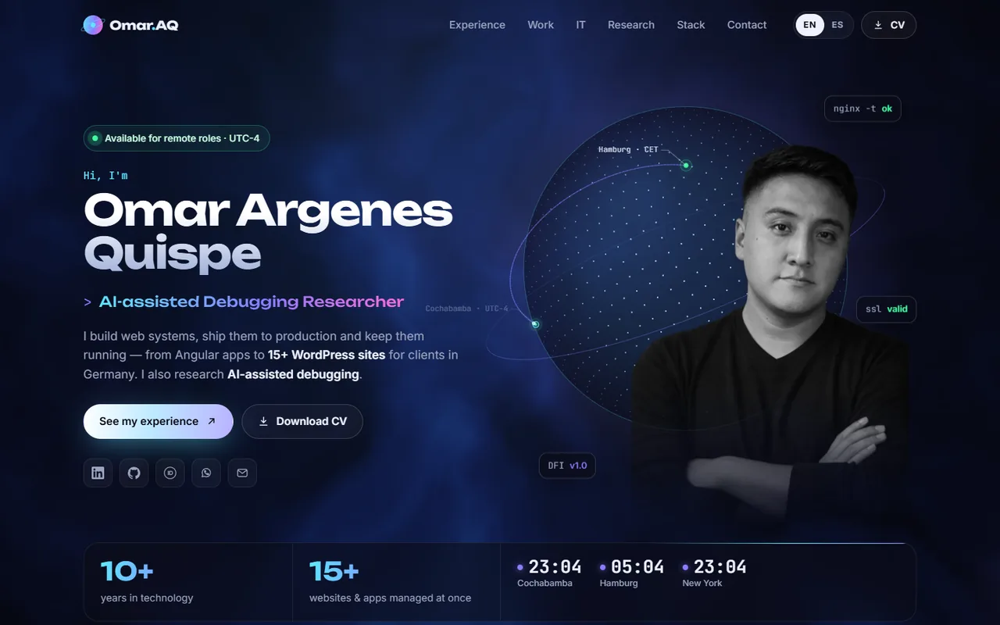
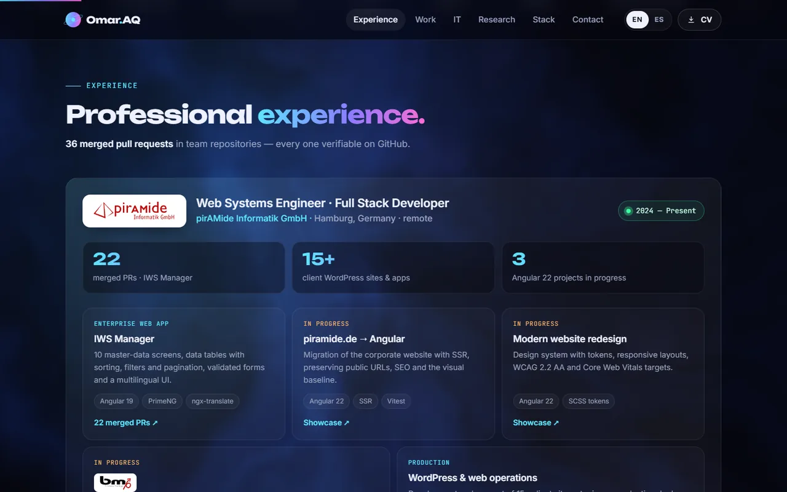
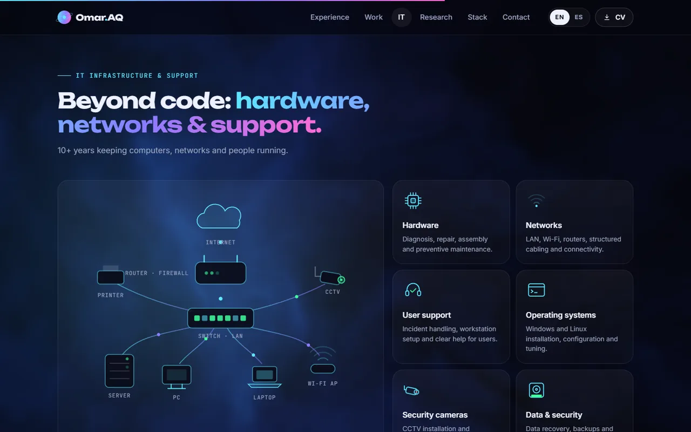
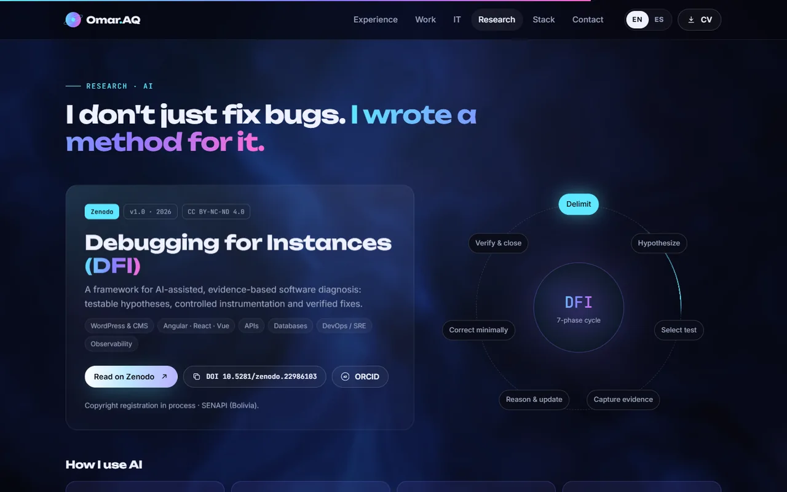
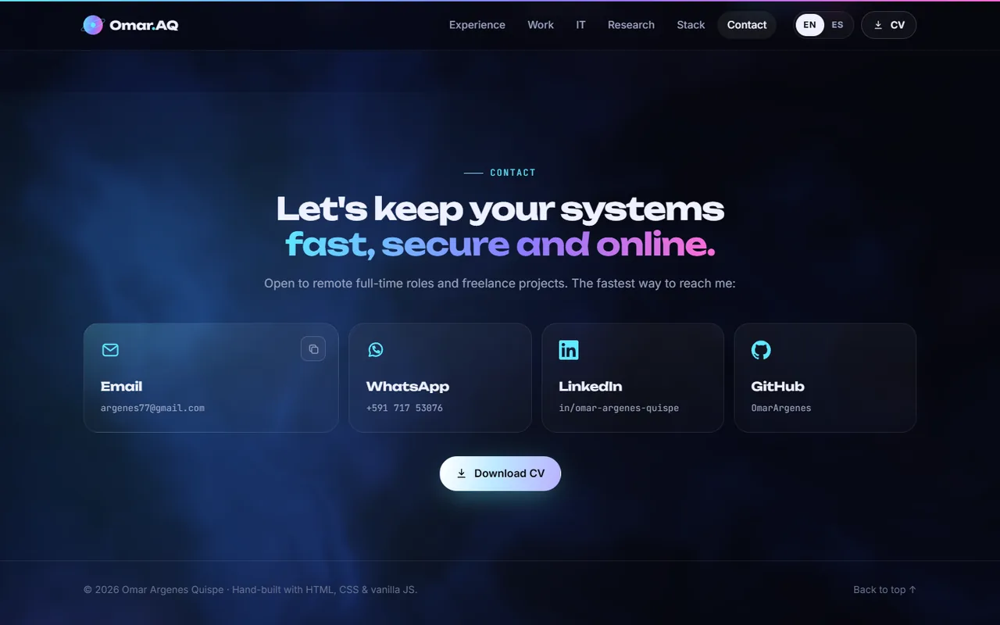
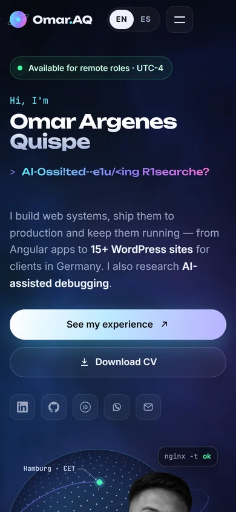
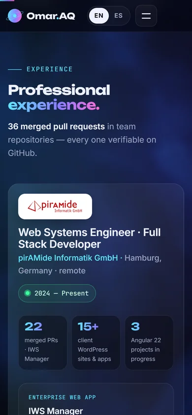
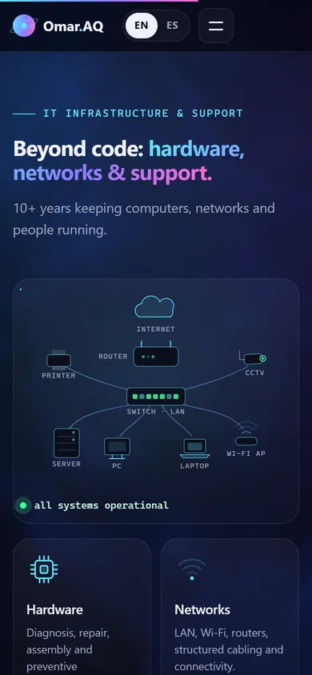

# Personal Portfolio — omar-argenes.netlify.app

Bilingual (English / Spanish) portfolio built by hand with **HTML, CSS and vanilla JavaScript** — no framework and no build step — with a WebGL background, a 3D globe on canvas and animated SVG diagrams.

**Live:** [omar-argenes.netlify.app](https://omar-argenes.netlify.app/)

> The source repository is private. This repository presents the design and the engineering behind the site.

---

## Highlights

| Feature | How it works |
|---|---|
| **WebGL aurora background** | Custom fragment shader with domain-warped noise. A soft light follows the pointer; on touch devices it drifts on its own. Rendered at half resolution and paused when the tab is hidden. |
| **3D globe** | Canvas 2D projection of a point sphere with a great-circle arc between Cochabamba and Hamburg and a pulse travelling along it. Reacts to the pointer and stops when off-screen. |
| **Live world clock** | Current time in Cochabamba, Hamburg and New York with a day/night indicator (`Intl.DateTimeFormat`). |
| **Animated IT network** | SVG diagram — router, switch, server, workstations, Wi-Fi and CCTV — with data packets moving along the links (SMIL) and blinking status LEDs (CSS). |
| **Bilingual without duplication** | English text lives in the HTML and is captured at load; only the Spanish dictionary is kept in JavaScript. A dev check warns about missing translations. |
| **Verifiable content** | Experience links to real merged pull requests and project showcases on GitHub. |

## Screenshots

| Experience | IT infrastructure |
|---|---|
|  |  |

| Research (DFI) | Contact |
|---|---|
|  |  |

### Mobile

  
  
  

## Quality

- **Responsive** from 360 px phones to wide desktops, checked with headless Chrome at several widths.
- **Accessibility:** skip link, visible focus styles, semantic sections, `aria` labels on icon links, and `prefers-reduced-motion` support (CSS, canvas, WebGL and SVG animations stop).
- **Performance:** WebP images with explicit sizes, lazy-loaded screenshots, animations paused when not visible, no framework runtime.
- **SEO & sharing:** Open Graph image, canonical URL and `Person` structured data (JSON-LD).

## Stack

HTML · CSS (custom properties, grid, `@property`) · JavaScript (ES2020+) · WebGL · Canvas 2D · SVG / SMIL · Netlify

---

**Author:** [Omar Argenes Quispe](https://github.com/OmarArgenes) · [Portfolio](https://omar-argenes.netlify.app/)
